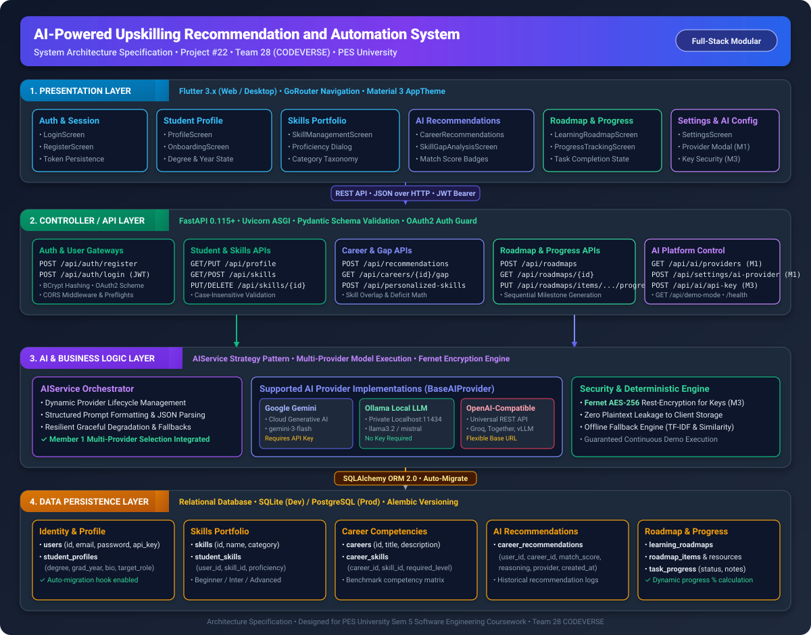
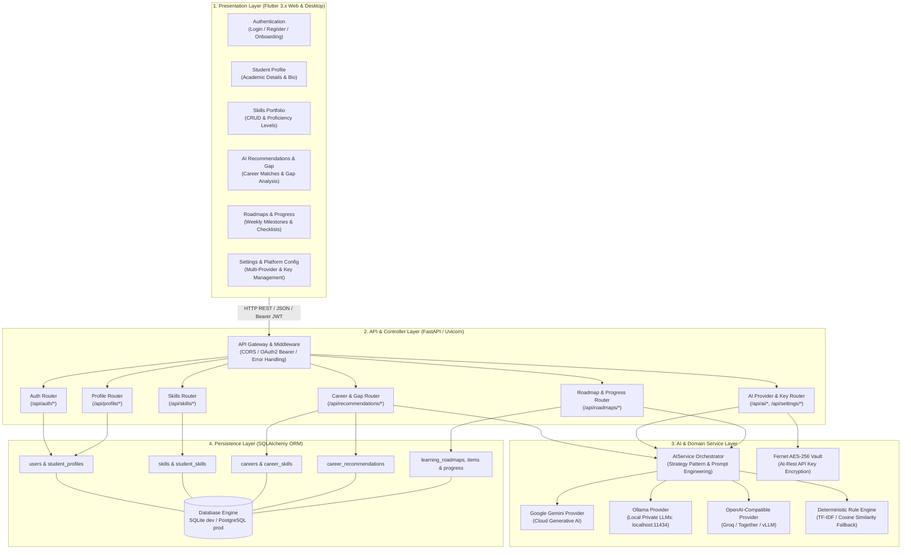
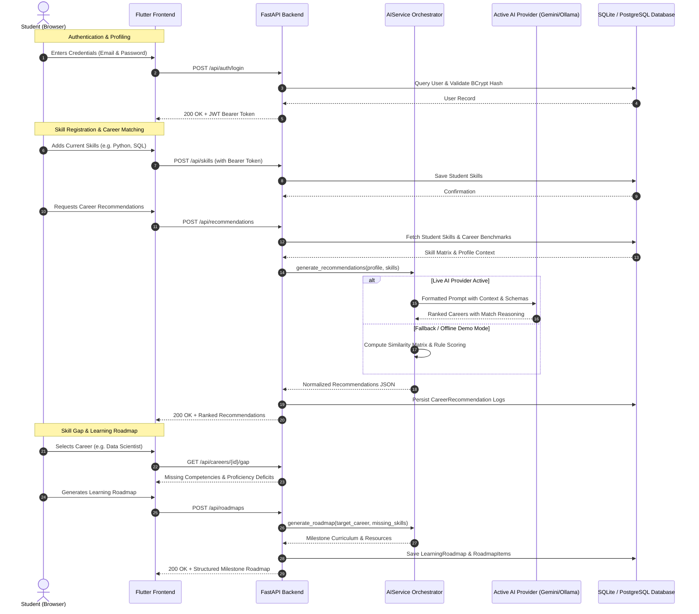
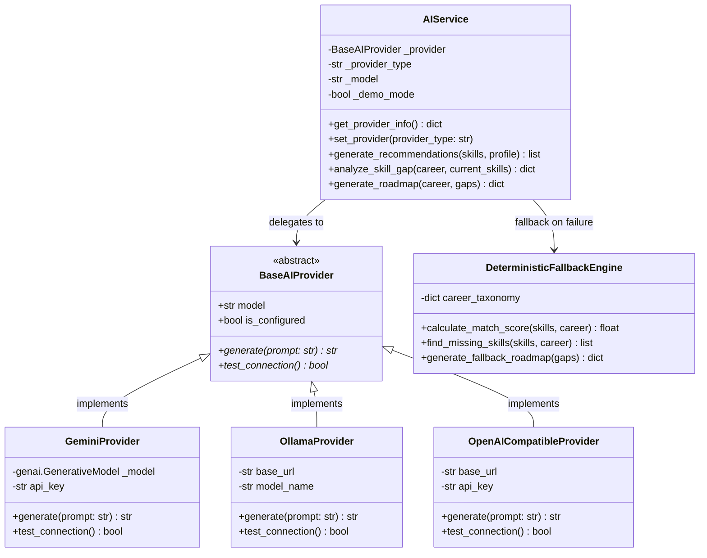
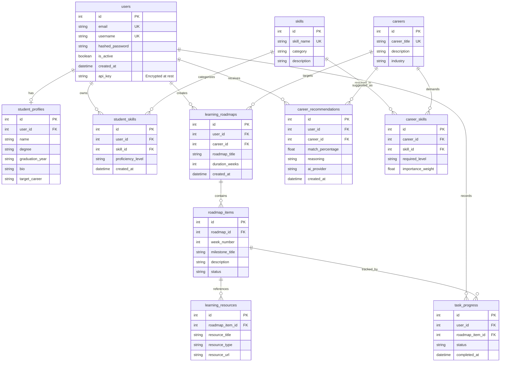

# Software Architecture Specification

## Project #22: AI-Powered Upskilling Recommendation and Automation System for Students
**Team 28 — CODEVERSE**  
**Course:** Software Engineering (Sem 5), PES University  
**Document Version:** 2.0 (Updated Post-Sprint with Multi-AI Provider & Key Security Architecture)

---

## 1. High-Level Architecture Diagram

The system employs a **Layered Modular Monolith Architecture** designed to maximize separation of concerns, testability, and security while keeping deployment simple for university evaluation and production scalability.

---

## 2. Interactive Mermaid Architecture Views

### 2.1 System Architecture & Layered Interaction

---

### 2.2 End-to-End Student Workflow Sequence

---

### 2.3 AI Provider Strategy Pattern (Class Architecture)

---

### 2.4 Entity-Relationship (ER) Schema

---

## 3. Detailed Layer Descriptions

### 3.1 Presentation Layer (Frontend)
- **Technology:** Flutter 3.x (compiled for Web and Windows Desktop) using Dart.
- **Navigation:** Declarative routing configured via `GoRouter` with protected authentication redirects (`/login`, `/register`, `/dashboard`, `/profile`, `/skills`, `/career-recommendations`, `/skill-gap`, `/roadmap`, `/progress`, `/settings`).
- **State Management & Services:** 
  - `APIClient` handles all HTTP communication, automatic JWT header injection, error deserialization, and token caching via `SharedPreferences`.
- **UI Design System:** Standardized Material 3 palette (`AppColors`, `AppCard`, `StatusPill`, `PageContainer`) ensuring accessible contrast and responsive multi-column layouts across desktop and mobile form factors.

### 3.2 API Gateway & Controller Layer (Backend)
- **Technology:** FastAPI running on the high-performance Uvicorn ASGI server.
- **Middleware & Security:**
  - `CORSMiddleware`: Secure cross-origin resource sharing supporting wildcard localhost ports for dynamic Flutter Web builds.
  - `OAuth2PasswordBearer`: Authentication route protection using RFC-standard Bearer tokens.
  - `passlib[bcrypt]`: Salted, one-way password hashing protecting user credentials.
- **API Endpoints:**
  - `/api/auth/*`: Registration, login, and JWT validation.
  - `/api/profile/*`: Student demographic, academic degree, and target aspiration management.
  - `/api/skills/*`: Case-insensitive skill portfolio management (`Beginner`, `Intermediate`, `Advanced`).
  - `/api/recommendations/*`: ML and AI-driven career matching.
  - `/api/careers/{id}/gap`: Gap comparison between user competencies and industry requirements.
  - `/api/roadmaps/*`: Structured sequential curricula generation and milestone tracking.
  - `/api/settings/*` & `/api/ai/*`: Dynamic AI provider selection, health probes, and at-rest key encryption.

### 3.3 AI Intelligence & Business Logic Layer
- **Strategy Pattern (`AIService`):** Decouples user-facing recommendation workflows from underlying AI model vendors.
- **Supported Providers:**
  1. **Google Gemini:** Cloud LLM (`gemini-3-flash-preview` / `gemini-pro`) for high-reasoning synthesis.
  2. **Ollama:** Self-hosted local inference (`localhost:11434`, `llama3.2`, `mistral`) for zero-cost, fully private processing without external API keys.
  3. **OpenAI-Compatible:** Universal adapter supporting open-weight hosted APIs (Groq, Together AI, vLLM).
- **Security & Privacy:**
  - Fernet symmetric AES-256 encryption (`app/services/encryption.py`) encrypts API keys before storing them in the database.
  - Keys are never serialized to the frontend or written to server logs.
- **Deterministic Fallback Engine:** Rule-based heuristic matrix ensuring 100% test reliability and graceful demo mode execution even without network access or valid API credentials.

### 3.4 Data Persistence Layer
- **ORM:** SQLAlchemy 2.0 with strongly typed models.
- **Storage Engines:** SQLite (`upskilling.db`) for lightweight local development; seamless compatibility with PostgreSQL for production.
- **Migration & Integrity:** Self-healing auto-migration hooks on server startup (`Base.metadata.create_all` with schema-safe column alterations) and Alembic versioning.

---

## 4. Team Ownership & Responsibilities

| Member | Primary Architecture Ownership | Key Modules Owned |
| :--- | :--- | :--- |
| **Member 1 (Current User)** | **AI Provider Selection & Architecture** | `SettingsScreen` Provider Selection Dialog, Supported Provider Catalog, Active Provider Showcase Card, `set_provider()` API |
| **Member 2** | **AI Model Selection** | Dynamic model listing, provider-compatible model persistence, active model runtime synchronization |
| **Member 3** | **Secure API Key Configuration** | Fernet AES-256 at-rest key encryption, authenticated `/api/ai/api-key` endpoint, masked client key configuration |
| **Member 4** | **Notification Preferences** | User alert preferences, notification persistence, and system delivery rules |

---

## 5. Architectural Quality Attributes

- **Modularity:** High cohesion within modules (Auth, Skills, AI, Roadmap) and low coupling via clear REST endpoints.
- **Security:** Zero plaintext secret storage, HTTPS-ready architecture, parameterized SQL queries preventing injection, and robust CORS preflight protection.
- **Resilience:** Multi-tier fallback strategy guarantees continuous application uptime even during third-party AI downtime or quota exhaustion.
- **Portability:** Container-ready Python backend and cross-platform Flutter frontend that compiles identically to Web, Windows, macOS, and Linux.
